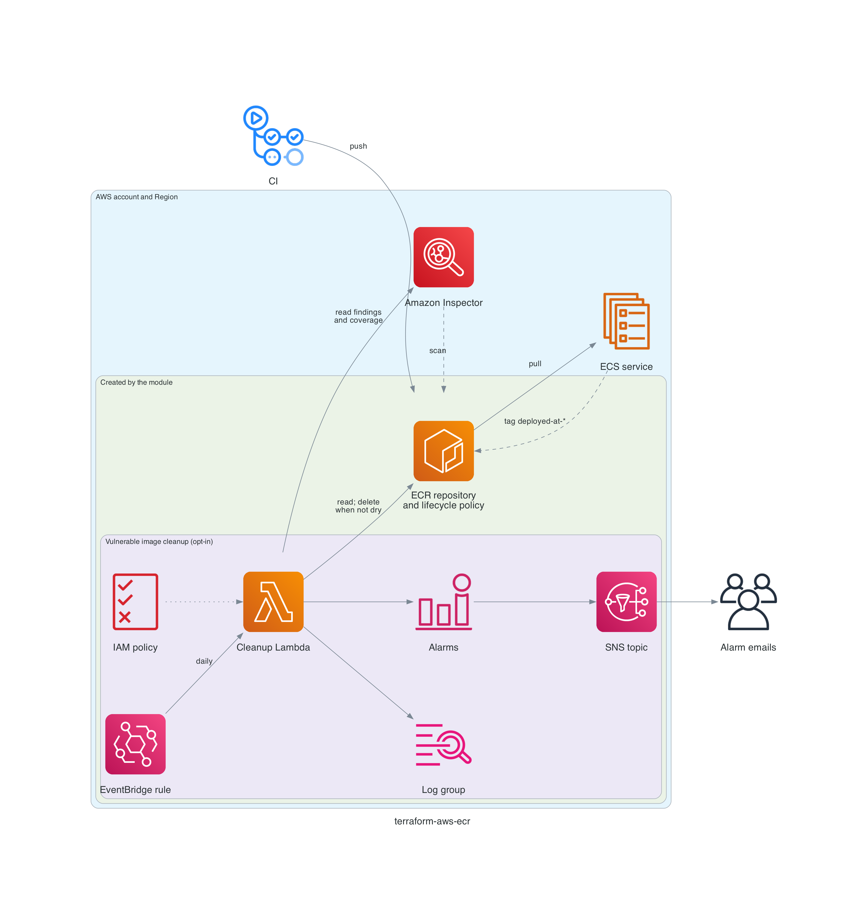
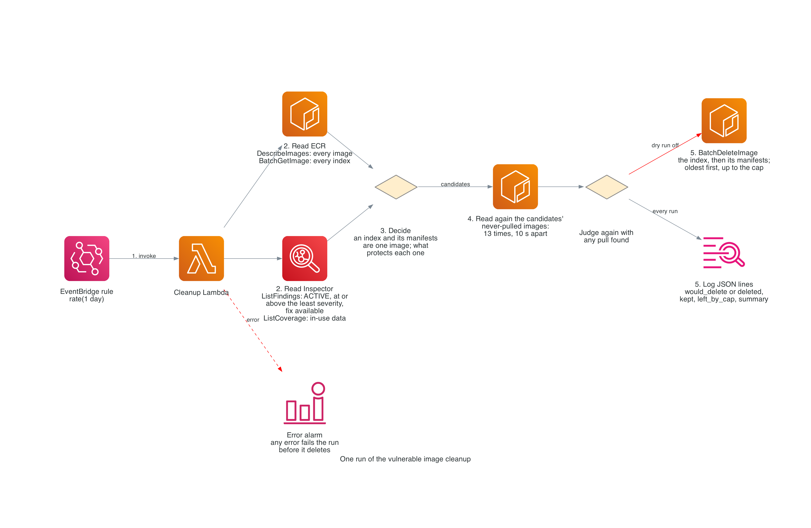

# Architecture

This page explains what the module creates and how it works: the repository, the lifecycle policy that expires its
images, and the opt-in job that deletes the images Amazon Inspector reports vulnerable.

## Overview



The module always creates the repository and its lifecycle policy. The vulnerable image cleanup, on the right, exists
only when `vulnerable_image_cleanup_enabled` is true. Off, the module creates nothing for it.

What the module doesn't create: the images (your CI pushes them), the `deployed-at-*` tags (the InfraHouse
[ECS module](https://github.com/infrahouse/terraform-aws-ecs) adds them after a successful deployment, when its
`enable_ecr_image_tagging` is true), and Amazon Inspector's scanning, which is configured for the registry, not the
repository.

## The Repository

`aws_ecr_repository` named `repo_name`, tagged with `environment`, `service` (from `service_name`),
`created_by_module` and `module_version`. `force_delete` lets Terraform destroy it while it still holds images.

The module sets no encryption or scanning options: ECR encrypts the repository with AES-256 by default.

The module doesn't set tag immutability, so tags are mutable, ECR's default. A principal allowed `ecr:PutImage` can
move a tag to another image, or add a `deployed-at-*` tag to any image, and so make a malicious image look like a
known-good deployment or a rollback candidate. Immutable tags would stop the first, not the second: ECR still accepts
a new tag on an existing image. Grant `ecr:PutImage` only to CI and to the deployment Lambda.

## The Lifecycle Policy

`policy.tf` builds the policy with `aws_ecr_lifecycle_policy_document`. Each lifecycle input that is set adds one rule,
and each tag in `retain_tags` adds one more. With `n` retained tags, the rules and their priorities are:

| Priority | Input | Selects | Expires |
|----------|-------|---------|---------|
| 1 … n | `retain_tags` | The one image with the tag | Nothing |
| n + 1 | `rollback_candidate_retain_count` | Rollback candidates | All but the newest N |
| n + 2 | `rollback_candidate_retain_days` | Rollback candidates | Those pushed over N days ago |
| n + 3 | `expire_count_tagged` | Tagged images that match the filter | All but the newest N |
| n + 4 | `expire_days_tagged` | Tagged images that match the filter | Those pushed over N days ago |
| n + 5 | `expire_count_untagged` | Untagged images | All but the newest N |
| n + 6 | `expire_days_untagged` | Untagged images | Those pushed over N days ago |

Each tag in `retain_tags` gets a rule of its own, which selects the one image that carries the tag and keeps it: one
image at most carries a tag. A rollback candidate is an image with a tag that starts with
`rollback_candidate_tag_prefix`. The tagged images' filter is `tag_prefix_list` or `tag_pattern_list`.

A rule that is off leaves a gap in the priorities, which ECR allows. For example, `retain_tags = ["pinned-1",
"pinned-2"]`, `rollback_candidate_retain_count = 3`, `expire_days_tagged = 365` and `expire_count_untagged = 5` give
rules at priorities 1, 2, 3, 6 and 7.

ECR accepts only one rule per tag filter and one rule for untagged images. So of each pair, the count and the days,
set one: a policy with both is refused at `terraform apply` (see [Troubleshooting](troubleshooting.md)). The module
also needs at least one rule: with no lifecycle input set, `terraform plan` fails.

### How ECR Applies the Rules

ECR documents its [evaluation rules](https://docs.aws.amazon.com/AmazonECR/latest/userguide/LifecyclePolicies.html).
The ones that shape this module:

- ECR evaluates every rule, then applies them by priority, the lowest number first.
- An image is expired by one rule at most.
- A rule can't expire an image whose tags match a higher-priority rule's filter, even when that rule keeps it.
- A rule still counts the images that higher-priority rules select. They take places in its count; it just can't
  expire them.
- A count rule sorts its images by push time, newest first, and expires those after the first N.
- An image that an index (a multi-architecture manifest list) references isn't expired while the index is there.
- The rules select images in the standard storage class only: archived images are outside them.
- ECR expires an image within 24 hours after it meets a rule's criteria.

### Rollback Candidates and Retained Tags

The retained tags take the first priorities so that no other rule can expire their images. The rollback candidate
rules come next, so that the tagged-image rules can't expire a deployed image either. Every rule after them still
counts those images.

An example, with these inputs:

```hcl
retain_tags                     = ["v-ghi9012"] # the image a migration task pins
rollback_candidate_retain_count = 3
expire_count_tagged             = 4
tag_prefix_list                 = ["v"]
```

The rules are: priority 1 keeps `v-ghi9012`, priority 2 keeps 3 rollback candidates, priority 4 keeps 4 images with a
tag that starts with `v`. In a repository with these images, newest first:

```
IMAGE  TAGS                         PUSHED   PRIORITY 1   PRIORITY 2          PRIORITY 4         RESULT
img-A  v-abc1234, deployed-at-...   1d ago               kept (1 of 3)       counted (1 of 4)   kept
img-F  v-pqr1234                    2d ago                                   kept (2 of 4)      kept
img-B  v-def5678, deployed-at-...   4d ago               kept (2 of 3)       counted (3 of 4)   kept
img-G  v-stu5678                    6d ago                                   kept (4 of 4)      kept
img-H  v-vwx9012                    9d ago                                   expires            expired, priority 4
img-C  v-jkl3456, deployed-at-...   13d ago              kept (3 of 3)       can't expire it    kept
img-D  v-mno7890, deployed-at-...   27d ago              expires             can't expire it    expired, priority 2
img-I  v-ghi9012                    40d ago  kept                            can't expire it    kept
```

ECR's lifecycle policy preview gives the same result for these images.

- `img-I` is the oldest, but priority 1 selects it, so no other rule can expire it.
- `img-C` is past the tagged-image rule's 4, but priority 2 selects it as a rollback candidate.
- `img-H` expires although only two images without a `deployed-at-` tag are newer: the rollback candidates `img-A` and
  `img-B` take two of the tagged-image rule's 4 places.

A retained image that is also a rollback candidate counts toward `rollback_candidate_retain_count` the same way: while
it is among the newest, it takes one of those places.

The protection follows the tag. When `retain_tags` lists another tag, the old tag's image falls to the other rules
again.

## The Vulnerable Image Cleanup

Amazon Inspector reports a vulnerability in every image it monitors, whether anything runs the image or not. A
repository that keeps an image per commit carries one report per old image until the lifecycle policy expires it. The
cleanup deletes those images sooner: the ones Inspector reports vulnerable and that nothing protects.

### What Terraform Creates

All in `vulnerable_image_cleanup.tf`, each with `count`, so none of it exists while the cleanup is off:

- **The function**, through
  [terraform-aws-lambda-monitored](https://github.com/infrahouse/terraform-aws-lambda-monitored) 2.2.1:
  `<repo_name>-<hash>-vuln-cleanup` (the repository's name made safe for Lambda, cut to 40 characters, and 6
  characters of its MD5), Python 3.12, a 300-second timeout and 256 MB. Its code is the `vulnerable_image_cleanup/`
  directory, packaged where Terraform runs. lambda-monitored also creates the log group, `/aws/lambda/<function name>`,
  kept 365 days; an SNS topic that emails `vulnerable_image_cleanup_alarm_emails`; an alarm on any error, and one on
  throttling.
- **An IAM policy** for the function's role:
    - `ecr:DescribeImages` and `ecr:BatchGetImage` on this repository;
    - `ecr:BatchDeleteImage` on this repository, only when `vulnerable_image_cleanup_dry_run` is false;
    - `inspector2:ListFindings` and `inspector2:ListCoverage`, which take no resource ARN.
- **An EventBridge rule** on `vulnerable_image_cleanup_schedule`, its target, and the permission that lets EventBridge
  invoke the function.

The module passes its inputs to the function as environment variables. The function reads ECR and Inspector in the
repository's Region, taken from the repository's ARN.

### One Run



1. **EventBridge invokes the function.** The event carries nothing the function reads.
2. **It reads.** First it checks that the packaged botocore models the fields it judges by (Inspector's `inUseCount`
   and `lastInUseAt`, ECR's `imageStatus` and `lastRecordedPullTime`): botocore drops fields its model lacks. Then:
    - ECR's `DescribeImages`: every image, tagged or not, archived ones included;
    - ECR's `BatchGetImage`: the manifest of every index, and of any image whose media type ECR doesn't give, to know
      which manifests an index references;
    - Inspector's `ListFindings`: the ACTIVE findings on this repository's images, at or above
      `vulnerable_image_cleanup_min_severity`, with a fix available;
    - Inspector's `ListCoverage`: each image's in-use data.

    The function checks each finding and coverage record again itself: its status, severity, fix, account and
    repository.
3. **It decides.** An index and the manifests it references (its platform images and its attestation) are one image:
   judged, capped and deleted together. A vulnerable image that nothing protects is a candidate. The candidates are
   ordered oldest first; the first `vulnerable_image_cleanup_max_deletions` are deleted in this run and the rest are
   left for the next.
4. **It reads again** the manifests it judged never pulled, in every candidate, those the cap leaves included: 13
   reads, 10 seconds apart, about two minutes. For about five minutes after a first pull shows, ECR's
   `DescribeImages` answers flap: one read shows the pull time, the next may not. If any read shows a pull, the function
   judges again with it. A pull only adds protection, so one round is enough. Dry runs read again too, and each run
   that does logs a `recheck` line.
5. **It acts.** In a dry run, it logs a `would_delete` line per image and deletes nothing. Otherwise it deletes each
   image in order: the index alone first, then the manifests it referenced that no index still in the repository
   references, level by level. Every run logs a `kept` line per vulnerable image something protects, a `left_by_cap`
   line per image the cap leaves, and a summary line.

An error fails the run, and the error alarm emails `vulnerable_image_cleanup_alarm_emails`. An error in steps 2 to 4
fails it before it deletes anything. See [Fail Closed](#fail-closed).

### What Protects an Image

A reason that holds for any manifest of an image protects the whole image, and an index that is kept keeps every
manifest it references. Each kept image's log line lists its reasons:

- **`retained_tag`**: it carries a tag in `retain_tags`.
- **`rollback_candidate`**: it is a rollback candidate the lifecycle policy keeps, while
  `vulnerable_image_cleanup_protect_rollback_candidates` is true (the default). The function applies the policy's
  rules: of the ACTIVE images with a tag that starts with `rollback_candidate_tag_prefix`, newest first and retained
  images counted, the first `rollback_candidate_retain_count`; or those pushed within
  `rollback_candidate_retain_days`. With neither set, the policy has no rollback candidate rule, and nothing is
  protected as one.
- **`in_use`**: Inspector counts a running ECS task or EKS pod that uses it (`inUseCount` above 0), or saw it in use
  within `vulnerable_image_cleanup_soak_days` (`lastInUseAt`). Or ECR recorded a pull of one of its platform images,
  or of a single-manifest image, within the soak (`lastRecordedPullTime`).
- **`in_use_unknown`**: the function can't tell whether it is in use. See [How It Judges Use](#how-it-judges-use).
- **`recent`**: it was pushed within `vulnerable_image_cleanup_min_age_days`, so an image waiting for its pin isn't
  deleted.
- **`not_active`**: it isn't ACTIVE: an archived image. The lifecycle rules don't select those either.

When two indexes share a platform image and only one is kept, the other index is deleted and the shared image stays.

### How It Judges Use

Use is judged per runnable manifest: a platform image, or a single-manifest image. An index's own pull time doesn't
count: the function reads every index with `BatchGetImage` each run, and ECR records that read as a pull. An
attestation's doesn't either: a pull that fetches the attestation fetches the platform image too, and a tool such as a
scanner may fetch the attestation alone.

For each runnable manifest:

- **Every Inspector coverage record of it has both `inUseCount` and `lastInUseAt`:** judged by Inspector's in-use
  data.
- **Inspector gives part of its in-use data:** unknown.
- **Inspector gives none, and ECR recorded a pull within the soak:** in use.
- **Inspector gives none, and ECR recorded a pull before the soak:** unknown. A long-running task that pulled it then
  may still run it.
- **Inspector gives none, ECR recorded no pull, and it was pushed on or after 2022-03-03:** never pulled, so never run:
  not in use.
- **Inspector gives none, ECR recorded no pull, and it was pushed before 2022-03-03:** unknown. AWS released ECR's
  pull time on 2022-03-02, so it may have been pulled without a record.

An image is `in_use_unknown` when any of its runnable manifests is unknown. Inspector leaves both in-use fields out for
an image it has never seen in use, and some accounts get them for no image at all; then the pull record decides.

Inspector's scans record no pull. The function's own reads record one on what they read with `BatchGetImage`: every
index, and any manifest whose media type ECR doesn't give. Such a manifest then looks pulled, and is kept.

What ECR's pull record doesn't show, so every tag that something pins belongs in `retain_tags`:

- **A first pull within the last day.** ECR refreshes the pull time at least once every 24 hours, so an old image
  deployed for the first time today, for a rollback say, may not show its pull yet.
- **A pull from elsewhere.** ECR records a pull on the image in the repository that served it. A replica in another
  Region or account, or the same image pulled from another repository and cached on a host, runs without a pull
  recorded here.
- **A pull by a principal in the registry's pull-time update exclusions.**

### Fail Closed

When the function can't judge, it deletes nothing:

- An API error, throttling that outlasts botocore's retries (standard mode, 10 attempts), or a page it can't read
  fails the run before any deletion.
- So does a manifest ECR doesn't return, an index that lists no manifests, or a botocore model without the fields
  above.
- A deletion ECR refuses fails the run, unless the image is already gone (`ImageNotFound`). ECR refuses to delete a
  manifest that an index still references (`ImageReferencedByManifestList`); the deletion order avoids that for the
  indexes the run read. Before the run fails, a `delete_failed` line names the image, the digests ECR did delete
  (`deleted_digests`) and the error.

The function then fails, and the error alarm emails `vulnerable_image_cleanup_alarm_emails`.

### Dry Run

`vulnerable_image_cleanup_dry_run` is true by default. A dry run logs what it would delete and calls no delete, and its
role has no `ecr:BatchDeleteImage` at all. Set it to false only once the dry runs' `would_delete` lines name images
you can do without: **a deletion can't be undone.**
