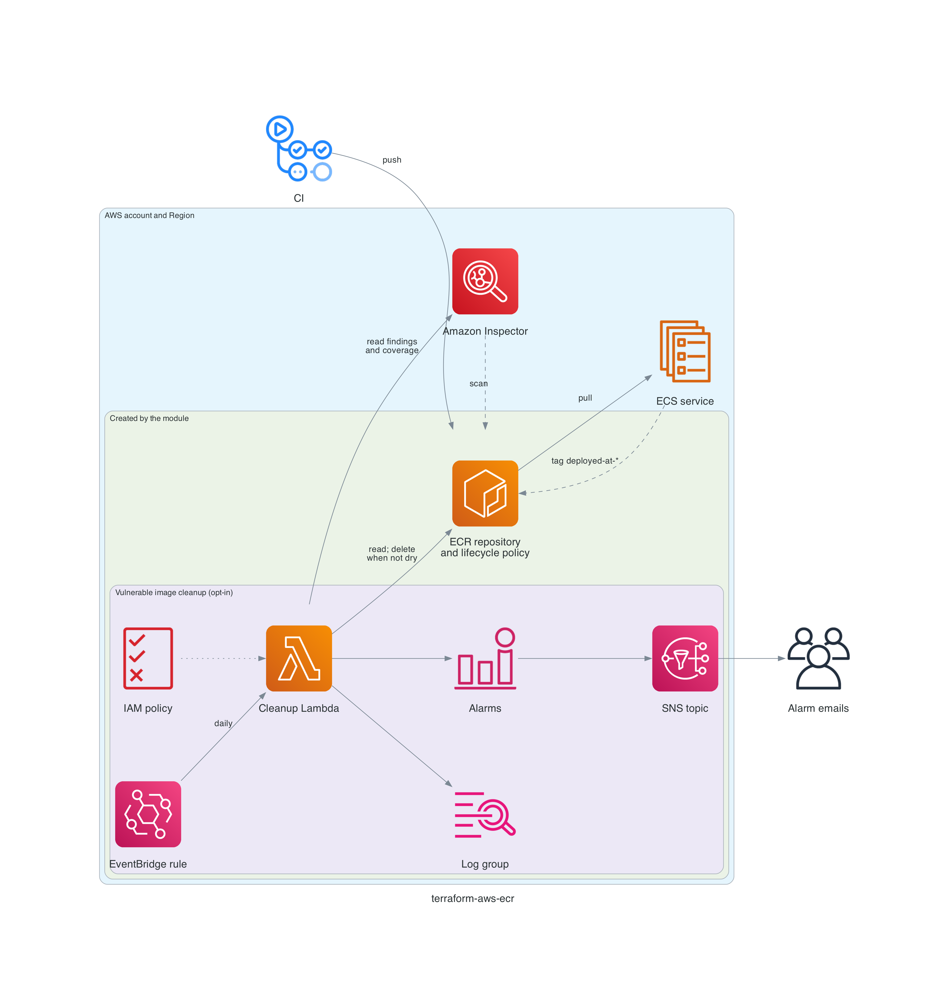

# InfraHouse ECR

This Terraform module creates an Amazon ECR repository with a lifecycle policy that expires old images and keeps the
ones you still need: your last deployments, kept as rollback candidates, and the images something pins by tag. An
opt-in scheduled job deletes the images Amazon Inspector reports vulnerable that nothing protects.



## Why This Module?

A repository takes a few lines of Terraform. A lifecycle policy that never expires an image something still runs takes
more care: ECR applies the rules by priority, a rule can't expire an image that a higher-priority rule selects but
still counts it, and some combinations of rules ECR refuses only at apply. The module writes the policy from a few
inputs, in an order that protects what runs:

- **Rollback candidates.** The images your deployments tagged `deployed-at-*` get rules of their own, ahead of the
  tagged-image rules, so the last N deployments stay however old they are and however many images CI pushes after
  them.
- **Retained tags.** Each tag in `retain_tags` gets a rule at the first priorities that keeps the one image carrying
  it. The image a scheduled task pins can't be expired by any other rule, even once it was deployed and carries a
  `deployed-at-*` tag.
- **The rule order, computed.** Retained tags first, then rollback candidates, then tagged images, then untagged ones.
  Add a retained tag, and the other rules move down without renumbering.
- **Vulnerable image cleanup.** Inspector reports vulnerabilities in every image it monitors, used or not. A daily
  Lambda deletes the vulnerable images that nothing protects. It keeps the retained images and the rollback candidates
  the lifecycle policy keeps, what ECS and Lambda run, what ran recently, what was pushed recently, and anything whose
  use it can't judge. It runs dry until you turn deletion on, and fails closed.

The module creates the repository and its lifecycle policy, and the cleanup when it is on. It sets no repository
policy, replication, scanning or encryption options.

## What the Cleanup Sees

The cleanup keeps what runs. What it sees, in the repository's account and Region:

- **Inspector's in-use data.**
- **ECR's pull record.**
- **ECS's running tasks and services:** every cluster's running tasks; the digests every service's revisions resolved
  its tags to, those its current deployment replaces or rolls back to included; and the task definitions of its
  PRIMARY and ACTIVE deployments and task sets. So a service scaled to zero, mid-deployment or rolling back is seen.
- **Lambda's versions:** every version of every container image function, not only `$LATEST`.

What it doesn't see:

- EKS;
- Docker run directly on EC2;
- an ECS task started by a schedule or by hand, outside a service (it sees one only while it runs);
- CodeBuild and App Runner;
- other Regions;
- anything else in the account that pulls from ECR, such as AWS Batch or SageMaker.

What to do about it: put any tag such a thing pins in `retain_tags`.

**Other accounts:** the job detects them through the repository's and the registry's policies, and keeps pulled
images. An image ECR recorded a pull of before the soak, that nothing in ECS or Lambda runs, is deleted only when
neither policy lets anyone outside the account pull from this repository. Something outside the account that pulls
with a role of this account looks like this account to the policies: put the tags it pins in `retain_tags` too.

## Features

- **ECR repository** tagged with `environment`, `service`, `created_by_module` and `module_version`.
- **Count- and age-based expiry** of tagged images, filtered by tag prefix or pattern, and of untagged images.
- **Rollback candidate retention**: keep the newest N images, or those within N days, with the tag prefix that the
  InfraHouse [ECS module](https://github.com/infrahouse/terraform-aws-ecs) adds after a successful deployment.
- **Retained tags**: exact tags whose images no other rule expires and the cleanup never deletes.
- **Vulnerable image cleanup**, off by default and dry when on: a scheduled Lambda, monitored by
  [terraform-aws-lambda-monitored](https://github.com/infrahouse/terraform-aws-lambda-monitored), with alarm emails
  and JSON logs of every decision.
- **Terraform 1.9 or later, below 2.0, and AWS provider 6** (`>= 6.0, < 7.0`).

## Quick Start

```hcl
module "ecr" {
  source  = "registry.infrahouse.com/infrahouse/ecr/aws"
  version = "1.0.2"

  repo_name    = "my-service"
  environment  = "production"
  service_name = "my-service"

  expire_days_tagged    = 365
  tag_prefix_list       = ["v"]
  expire_count_untagged = 5
}
```

Tagged images whose tag starts with `v` expire a year after they were pushed, and the 5 newest untagged images stay.
The module needs at least one lifecycle rule. [Getting Started](getting-started.md) goes through the prerequisites
and a first deployment.

## Documentation

- [Getting Started](getting-started.md): prerequisites and a first deployment
- [Architecture](architecture.md): the repository, how ECR applies the lifecycle rules, and the cleanup
- [Configuration](configuration.md): every input, and when to change it
- [Examples](examples.md): common uses, each a complete root module in the repository
- [Troubleshooting](troubleshooting.md): errors at plan and apply, and what the cleanup's logs say
- [Changelog](changelog.md): every change, release by release
